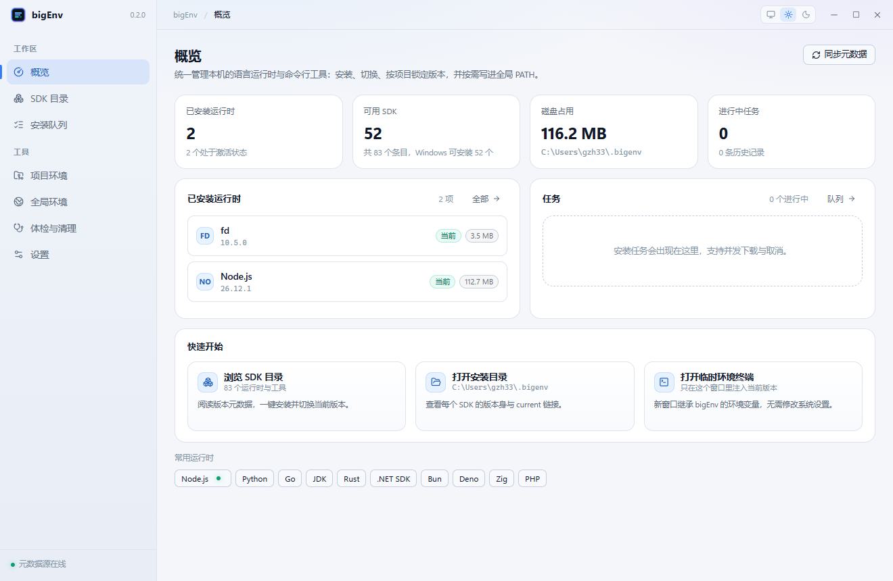
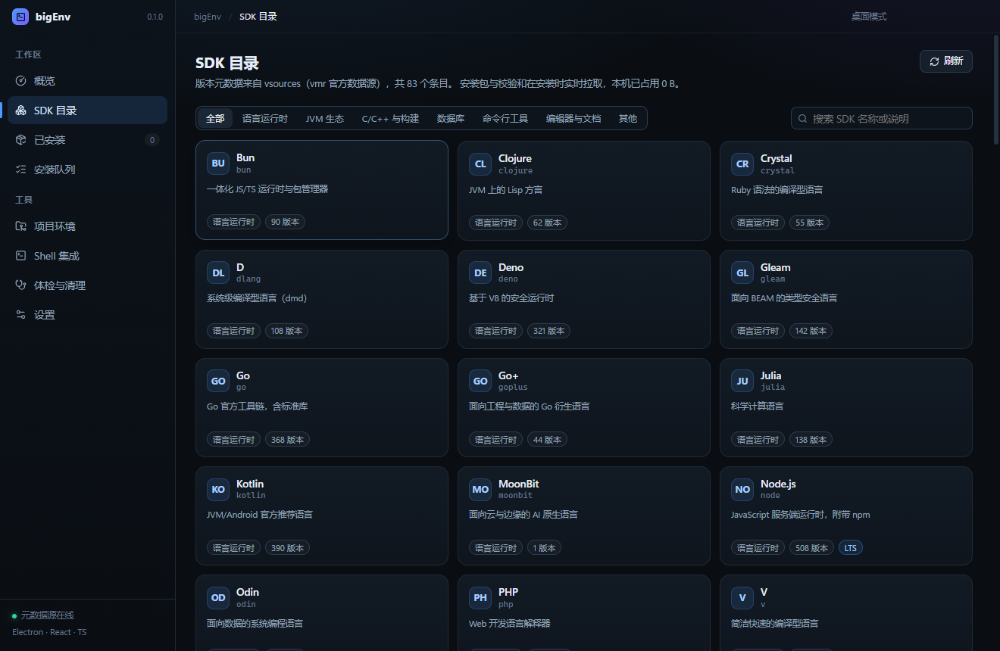
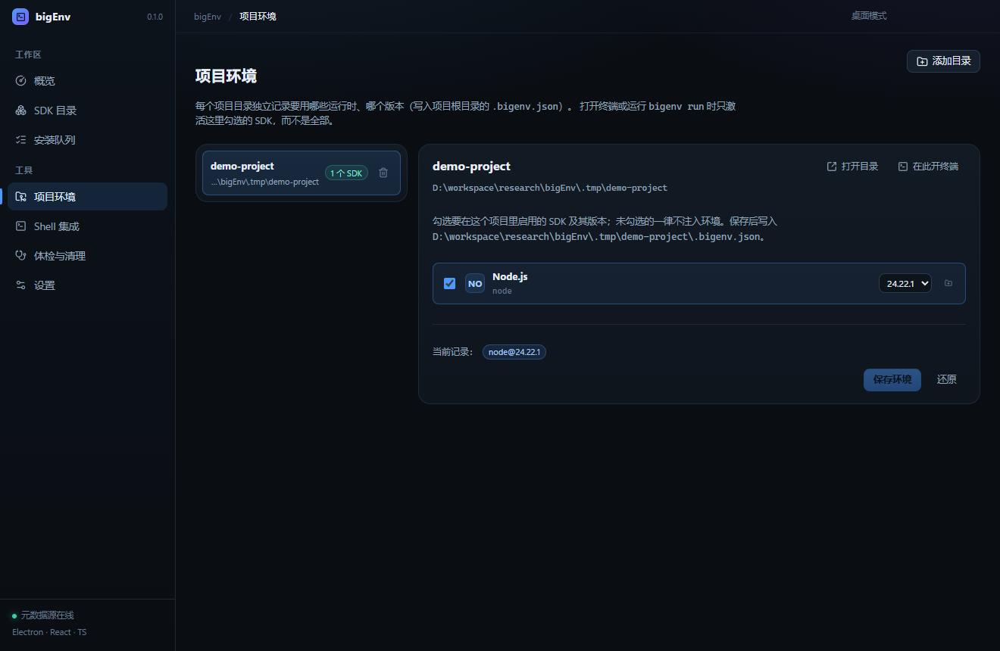
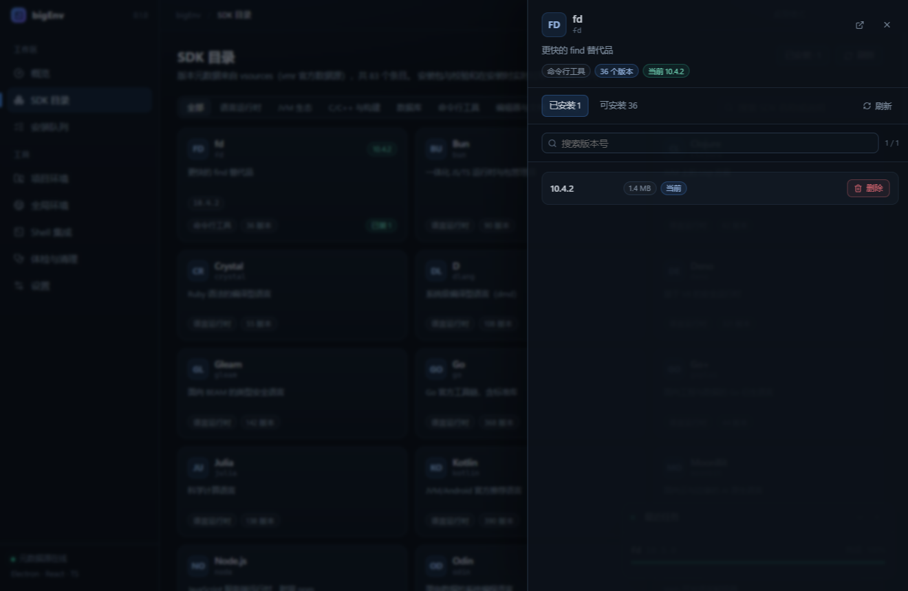
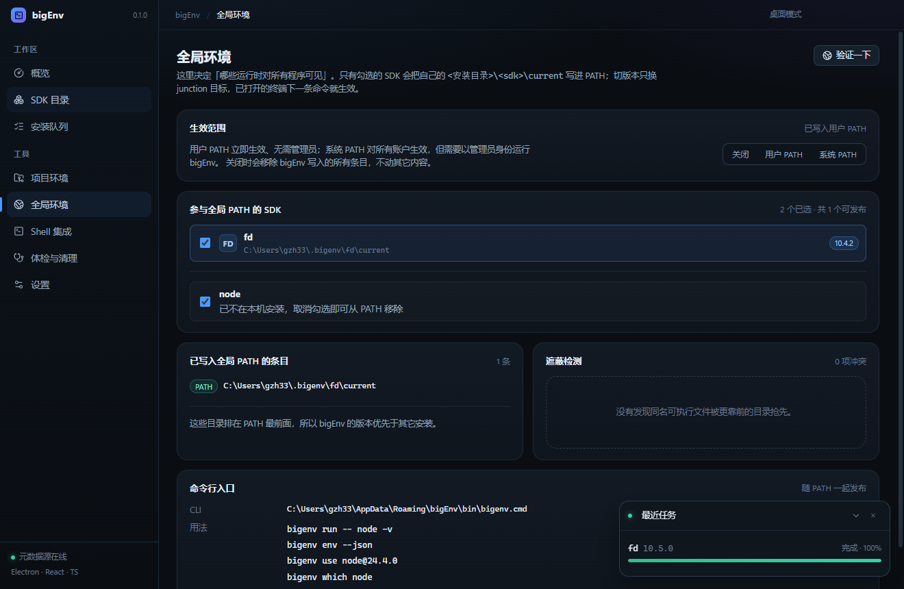
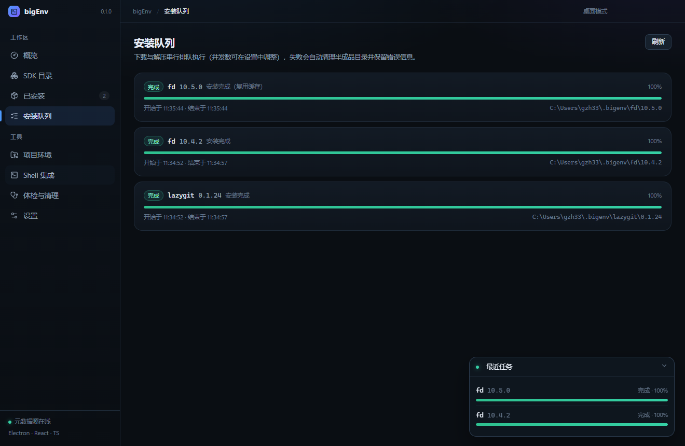
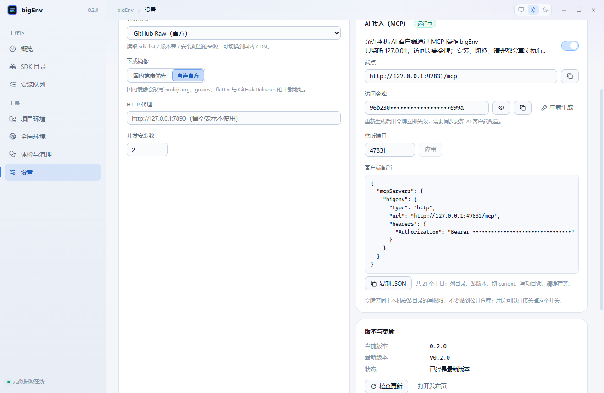
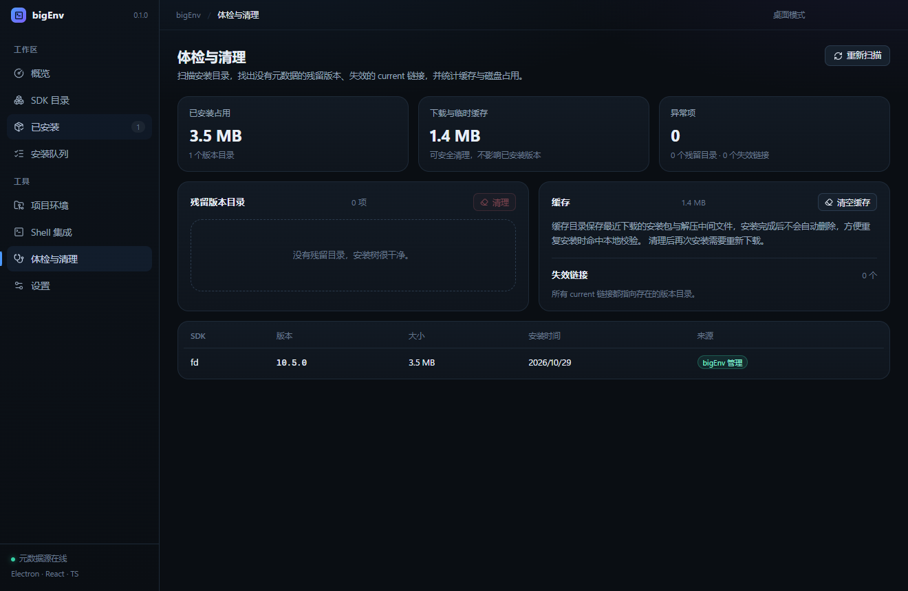

<p align="center">
  
</p>

# bigEnv

桌面端运行环境管理器：把 Node.js、Python、Go、JDK、Rust、.NET、Zig 这类语言运行时与命令行工具收进一个窗口，负责**发现版本 → 下载校验 → 解压安装 → 切换当前版本 → 全局 PATH 或项目锁 → 体检清理**。

灵感与元数据来自 [gvcgo/version-manager](https://github.com/gvcgo/version-manager)（vmr），数据源为 [gvcgo/vsources](https://github.com/gvcgo/vsources)。



## 能力

- **SDK 目录**：读取 vsources 的 83 个 SDK（Windows 上 52 个可直接安装），按分类浏览、搜索，支持镜像与代理；「已安装」筛选与卡片上的版本号把「能装什么」和「装了什么」放在同一页。点开卡片后，版本列表分「已安装 / 可安装」两页切换，装完或卸载后自动刷新，不用手动重开。
- **安装与切换**：zip / tar.gz 解压安装到 `~/.bigenv/<sdk>/<version>`，`current` 用 Windows junction 指向当前版本；切换只改链接，不复制文件。下载支持断点续传、sha256 校验、并发队列、取消与失败清理。点「安装」后抽屉自动关闭，进度交给右下角队列面板。
- **已安装管理**：在 SDK 目录页点开卡片即可看到已装版本号；设为当前、打开目录、删除都在同一处完成。删除某个版本后该行立即变成可重装状态，不会残留「当前」标记。
- **全局环境（可选）**：独立页面里先选「关闭 / 用户 PATH / 系统 PATH」，再逐 SDK 点「启用」选择哪些 `<安装根>\<sdk>\current` 要进入 PATH——cmd、IDE、AI agent 都能直接拿到，切版本只改 junction，已开终端的下一条命令即生效。只发布启用的 SDK；已卸载但仍留在清单里的 SDK 会标出来，点「移除」即从 PATH 清掉；每次写入都有行内「写入中」状态，失败会在卡片里给出原因和「重试」按钮。会检测「被更靠前的同名程序遮蔽」并点名提示。
- **`bigenv` CLI**：`bigenv run -- <cmd>` 按项目锁注入并执行、`env` 输出环境、`which` / `list` / `use` 管理版本，供脚本与 AI agent 调用，不要求装 Node。
- **项目环境**：登记多个项目目录，每个目录单独勾选要用哪些 SDK、哪个版本，写入该目录下的 `.bigenv.json`；打开终端或 `bigenv run` 时只激活勾选的 SDK。锁里记录但已经卸载的 SDK 仍会列出（标记「未安装」），取消勾选就能把它从配置里移除。格式只认 bigEnv 自己的 JSON 对象，不再兼容 `.vmr.lock`。
- **体检与清理**：统计安装占用与下载缓存，找出没有元数据的残留版本目录、失效的 `current` 链接，一键清理缓存或残留目录。
- **队列可控**：任务面板可随时关闭，安装队列页可一键清空已完成记录（历史只保留最近 30 条）。
- **版本与更新**：设置页挂出当前版本与最新版本，启动时自动检查（缓存 6 小时），发现新版本可以一键下载 Setup 或 portable 安装包，也可以打开 GitHub 发布页手动下载。
- **主题**：标题栏右上角的切换器支持「随系统 / 明亮 / 暗色」三档，Linux/macOS 与 Windows 的浅色、深色都做了配色（CSS `light-dark()`），选择会立即生效并记住；「随系统」会跟随操作系统实时切换。窗口是无边框的，右上角的最小化/最大化/关闭由应用自绘，尺寸一致、深浅配色统一。零配置可用，元数据源、镜像、代理、并发数、安装根目录都可在设置里改。
- **AI 接入（MCP）**：设置页一键开启本机 MCP 端点，把令牌填进 Claude Code、Cursor 等客户端的 `mcpServers`，AI 就能列 SDK、装版本、切 current、写项目锁、跑体检清理；端点只监听 `127.0.0.1`，关闭即停止监听。

| SDK 目录 | 项目环境 |
| --- | --- |
|  |  |

| 版本选择 | 全局环境 |
| --- | --- |
|  |  |

| 安装队列 | 设置 |
| --- | --- |
|  |  |

| AI 接入（MCP） |
| --- |
|  |

| 体检与清理 |
| --- |
|  |

## 激活方式

装好一个版本后，让它对「谁」可见由你决定，默认不碰注册表：

| 方式 | 覆盖范围 | 怎么用 |
| --- | --- | --- |
| 项目锁 | 该目录下的子进程 | 在项目环境页勾选 SDK 与版本，保存到 `.bigenv.json`；「在此开终端」或 `bigenv run -- <cmd>` 只注入勾选的那些 |
| 全局 PATH | 整台机器的所有新进程 | 全局环境页选「用户 PATH」或「系统 PATH」，再逐 SDK 点「启用」 |

全局 PATH 写入的是稳定目录 `<安装根>\<sdk>\current`（junction），不是带版本号的实体目录——所以切版本不需要改 PATH，也不需要重开已存在的终端（该终端里的下一条命令就会用新版本）。只有被启用的 SDK 才会进 PATH；清单为空时只发布 `bigenv` 启动器目录。选「系统 PATH」时点一下就弹出 Windows 管理员授权（UAC），批准后直接写 HKLM，不需要先以管理员身份重启应用；取消或失败时页面原地给出原因和「重试」，设置与已写入的 scope 都保持原样（切回「用户 PATH」也会弹一次 UAC，用来清掉系统 PATH 里的条目）。若更靠前的 PATH 里已有同名程序（例如别的版本管理器写进系统 PATH 的 node），页面会用红字点名冲突，bigEnv 不会去改别人的条目。

**CLI**（`%APPDATA%\bigEnv\bin\bigenv.cmd`，选全局 PATH 时自动进入 PATH）：

```powershell
bigenv list                     # 已安装版本，* 标记当前
bigenv which node               # 解析到的可执行文件
bigenv env --json               # 当前（或项目锁）环境，给父进程消费
bigenv run -- node -v           # 按项目锁注入后执行；无锁则用全部 current
bigenv use node@24.4.0          # 切换 current
```

`bigenv run` 会从当前目录向上找 `.bigenv.json` / `bigenv.json`，所以 AI agent 或构建脚本在项目里直接调它就能拿到正确版本，不需要 UI 或先开终端。

## 设置与更新

设置页把「即时生效」和「需要保存」分开：

- **开关即时生效**：主题与「显示不可安装的 SDK」点一下立刻写盘并广播，切页回来状态保持；安装根目录、元数据源、镜像、代理、并发数改完点「保存」生效。
- **文本项需要保存**：安装根目录、元数据源、镜像、代理、并发数属于「一次改一组」的参数，改动后页头出现「有未保存的修改」，点「保存」才整体生效；没改时保存按钮置灰。

「版本与更新」卡片显示当前版本、最新版本与状态。应用启动时会自动检查一次（结果缓存 6 小时），也可以点「检查更新」强制刷新。发现新版本时可以直接「下载更新」（自动挑 Setup 或 portable 安装包并落盘后打开）或「打开发布页」。

检查走三级回退，避免被限流卡死：GitHub Releases API → 抓取 releases 页面 HTML → 读取仓库里的 `package.json` 版本；仓库还没有正式 Release 时显示「仓库还没有发布版本」，检查失败会给出原因而不是静默。更新源指向 [gzhBigger/bigEnv](https://github.com/gzhBigger/bigEnv)（仓库改名前的 `gzh330205` 会 301 到新地址）。

## AI 接入（MCP）

设置页「AI 接入（MCP）」卡片可以打开一个本机 MCP 端点，让 AI 客户端直接驱动 bigEnv，而不用猜路径或手改 `.bigenv.json`。

1. 打开开关，端点固定为 `http://127.0.0.1:47831/mcp`（端口可改），首次启用会自动生成访问令牌。
2. 把卡片里的 JSON 复制到客户端的 `mcpServers` 配置，令牌放在 `Authorization: Bearer` 头里：

```json
{
  "mcpServers": {
    "bigenv": {
      "type": "http",
      "url": "http://127.0.0.1:47831/mcp",
      "headers": { "Authorization": "Bearer <token>" }
    }
  }
}
```

3. 客户端连上后可以直接说「装个 Node 24 并切过去」「这个项目锁 node 20 和 go 1.22」「清理一下下载缓存」。

| 类别 | 工具 | 说明 |
| --- | --- | --- |
| 查询 | `bigenv_list_sdks` / `bigenv_sdk_versions` / `bigenv_list_installed` / `bigenv_which` | 目录、可安装版本、已装列表、当前版本与路径 |
| 安装 | `bigenv_install` / `bigenv_job` / `bigenv_wait_job` / `bigenv_cancel_job` | 发起安装后可等待任务结束，与界面共用同一个队列 |
| 版本 | `bigenv_use` / `bigenv_uninstall` | 切换 current、删除版本（同时刷新 PATH） |
| 环境 | `bigenv_env_info` / `bigenv_set_path_mode` / `bigenv_set_path_sdks` | 查看或修改全局 PATH 范围与参与发布的 SDK（系统 PATH 会弹 UAC） |
| 项目 | `bigenv_projects` / `bigenv_project_save` / `bigenv_project_add` / `bigenv_project_remove` | 读、写 `.bigenv.json`，登记/移除项目目录 |
| 维护 | `bigenv_health` / `bigenv_clean` / `bigenv_check_updates` / `bigenv_open_terminal` | 体检、清缓存/残留、检查更新、按锁打开终端 |

端点是**无状态**的 Streamable HTTP：每个请求现场创建 server 与 transport，不维护会话，也不支持 `GET` 的 SSE 流。绑定地址固定 `127.0.0.1`，令牌用常量时间比较；关掉开关立即停止监听。令牌等同于本机安装目录的写权限，不要写进公开仓库；怀疑泄露时点「重新生成」，旧令牌立刻失效。

写操作走的是界面同一套服务：安装仍经过下载校验、并发队列与失败清理，切换版本仍会刷新 `current` 链接与全局 PATH，所以 AI 看到的状态和界面里的一致。系统 PATH 的写入依然需要用户在 UAC 弹窗里点「是」，MCP 调用不能代替这一步。

## 架构

```
src/
  main/        Electron 主进程（Node 侧全部系统能力）
    app.ts         组合根：registry / catalog / jobs / env / projects / health
    catalog.ts     元数据 → 可安装性判定、安装计划
    versions.ts    vsources 拉取、缓存、版本比较、镜像改写
    jobs.ts        安装队列（并发、进度、取消、清理）
    archive.ts     zip（yauzl）/ tar.gz（tar）解压，防路径穿越
    http.ts        undici 下载（代理、重试、sha256、进度）
    registry.ts    <installRoot>/<sdk>/<version> + current 链接 + .bigenv.json
    envManager.ts  按 SDK 发布全局 PATH、项目终端注入、CLI 启动器
    globalPath.ts  注册表 PATH 读写、托管条目识别、环境变更广播
    projects.ts    多项目登记、.bigenv.json 读写与按锁裁剪环境
    health.ts      占用统计、残留目录、失效链接
    mcp.ts         本机 MCP 端点（令牌鉴权、21 个 bigenv_* 工具）
    ipc.ts         bigenv:* 通道
  cli/         独立的 bigenv CLI（不依赖 electron，打包进 resources/cli.cjs）
  preload/     contextBridge 暴露 window.bigenv（Bridge 接口）
  renderer/    React 19 + zustand 界面
  shared/      主进程与渲染进程共享的类型与分类常量
```

前后进程的唯一契约是 `src/shared/types.ts` 里的 `Bridge`；渲染进程在没有 `window.bigenv` 时自动使用 `src/renderer/lib/mock.ts`，因此可以在普通浏览器里调样式。

设计取舍记录在 [.agents/notes/](.agents/notes/)：

- [桌面端的技术栈与主进程分层](.agents/notes/implemented/architecture/2026-10-29-electron-desktop-shell.md)
- [直接消费 vsources 元数据，不移植 vmr 的 Lua 运行时](.agents/notes/implemented/feature/2026-10-29-vsources-catalog-engine.md)
- [项目锁与临时环境注入](.agents/notes/implemented/feature/2026-10-29-env-injection-and-project-lock.md)
- [全局 PATH 激活与 bigenv CLI](.agents/notes/implemented/feature/2026-10-29-global-path-and-cli.md)
- [设置页的即时开关与更新检查](.agents/notes/implemented/feature/2026-10-29-settings-instant-toggle-and-update-check.md)
- [打包与图标](.agents/notes/implemented/process/2026-10-29-packaging-and-icon.md)
- [用 CDP 脚本验证界面](.agents/notes/implemented/process/2026-10-29-verification-harness.md)

## 开发

需要 Node 22+ 与 pnpm。

```powershell
pnpm install
# pnpm 11 会跳过 electron 的安装脚本，需要手动补一次（国内可用 npmmirror）
$env:ELECTRON_MIRROR="https://npmmirror.com/mirrors/electron/"
node node_modules\electron\install.js

pnpm dev        # vite + esbuild watch + electron
```

其它命令：

```powershell
pnpm typecheck      # 主进程与渲染进程分别 tsc --noEmit
pnpm build          # 主进程（esbuild）+ 渲染进程（vite）
pnpm start          # build 后直接启动
pnpm dist           # electron-builder 打 Windows 安装包到 release/
pnpm verify-notes   # 校验 .agents/notes 的结构与格式
```

> 本机环境若预设了 `ELECTRON_RUN_AS_NODE=1`，启动前必须清空，否则 Electron 会以 Node 模式运行主进程并报 `Cannot read properties of undefined (reading 'isPackaged')`：
>
> ```powershell
> $env:ELECTRON_RUN_AS_NODE=$null
> npx electron . --remote-debugging-port=9333
> ```

## 打包与分发

```powershell
pnpm dist      # build 之后调 electron-builder，产物在 release/
pnpm icon      # 重新生成 build/icon.png 与 build/icon.ico
```

`release/` 里有三种形态，任选其一：

| 产物 | 用途 |
| --- | --- |
| `bigEnv 0.1.0.exe` | portable 单文件：双击直接运行，自解压到临时目录，不写注册表 |
| `bigEnv Setup 0.1.0.exe` | NSIS 安装包：可选安装目录、开始菜单快捷方式、自带卸载器 |
| `win-unpacked\bigEnv.exe` | 免安装目录版，排查问题用 |

图标由 `scripts/make-icon.mjs` 用 Electron 渲染 512×512 后打包成多尺寸 ICO，不依赖任何绘图库。安装包**未做代码签名**，首次运行 Windows 会提示「未知发布者」，选择「更多信息 → 仍要运行」即可。

## 数据与磁盘布局

```
%APPDATA%\bigEnv\            设置、日志、元数据缓存、下载缓存、生成的 env 脚本
~/.bigenv/                   默认安装根（可在设置里改）
  fd/
    10.5.0/                 实体目录，内含 .bigenv.json
    current -> 10.5.0       Windows junction
  lazygit/
    0.1.24/
    current -> 0.1.24
```

`.bigenv.json` 记录 installer、binDirs、envs、sourceUrl、sha256 与安装时间；没有该文件的版本目录会标记为「外部目录」，体检时只提示、不自动删除。

## 验证

```powershell
# 终端 1：起窗口
$env:ELECTRON_RUN_AS_NODE=$null
npx electron . --remote-debugging-port=9333

# 终端 2：截图 / 在页面里执行表达式
node scripts/capture.mjs .tmp/overview.png 9333 --eval "[...document.querySelectorAll('.nav-item')].find(b=>b.textContent.includes('概览'))?.click()"
node scripts/eval.mjs "await window.bigenv.installed.list()" 9333
```

已实测走通的链路：`fd 10.5.0`（GitHub Releases zip）与 `lazygit 0.1.24`（tar.gz）完整安装、`current` 切换后 `fd --version` 跟随变化、删除当前版本后无残留链接、`bigenv which node` 能指出当前激活版本、项目锁文件识别已装/未装。

## 已知限制

- 仅实现 zip 与 tar.gz；`.tar.xz`、`.tar.zst`、7z 会明确报「暂不支持」。
- 仅 `conda` 安装器的 SDK（clang、ffmpeg、gcc、python 等）需本机已安装 conda；未内置 conda 引导。
- 官方安装程序类包（cygwin、msys2、vscode、rustup、miniconda 等）不做静默安装，UI 提示需手动运行。
- 元数据里 `size` 常为 `0`、部分包没有 `sum`，此时界面不显示大小、下载只校验大小。
- 主要面向 Windows（junction、注册表 PATH）；macOS/Linux 的路径与脚本分支已存在但未实机验证。
